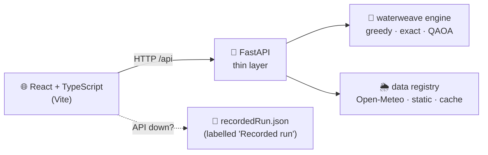

<div align="center">

```text
 __      __  _  _____ ___ ___ __      __ ___   _  __   __ ___
 \ \    / / /_\|_   _| __| _ \\ \    / /| __| /_\ \ \ / /| __|
  \ \/\/ / / _ \ | | | _||   / \ \/\/ / | _| / _ \ \ V / | _|
   \_/\_/ /_/ \_\|_| |___|_|_\  \_/\_/  |___/_/ \_\ \_/  |___|
```

# 💧🧵⚛️ WATERWEAVE ⚛️🧵💧

### *Seven deliveries requested. Water for four. Who gets thirsty?*

**Fair & resilient municipal water allocation during drought, as a 12-qubit Qiskit QAOA circuit, raced live against exact and greedy solvers, in a web app that presents itself.**

<br>


-orange?style=for-the-badge)

<br>

**[⚡ Quick start](#-launch-sequence)** ·
**[🎬 Live demo](#-the-show-guided-presentation-mode)** ·
**[🔬 The quantum bit](#-the-quantum-engine-room)** ·
**[🥊 The fight](#-the-fight-classical-vs-quantum)** ·
**[🧯 Honest limits](#-the-part-where-we-tell-you-what-doesnt-work)**

</div>

---

## 🎛️ Mission Control

| | |
| :--- | :--- |
| 🏷️ **Project** | WATERWEAVE — Fair & Resilient Municipal Water Allocation via Qiskit QAOA |
| 🏁 **Track** | Track 2: Open-Domain Optimization & Real-World Solvers |
| 👥 **Team** | WATERWEAVE Project Team |
| 🎥 **Video** | *[Pending submission video URL — to be uploaded before the final deadline]* |
| ⏱️ **Live demo timestamp** | *[Pending — e.g. 02:15, once recorded]* |

> ⚠️ **Before submitting:** set the video link to *"Anyone with the link can view"* (Google Drive) or *Unlisted / Public* (YouTube). Locked links cannot be scored.

### 🧑‍🚀 Crew

| Name | Email | GitHub |
| :--- | :--- | :--- |
| **Yukith M Joseph** | yukithj@gmail.com | [@Zynx095](https://github.com/Zynx095) |

---

## 📖 Table of Contents

1. [🚰 The Problem](#-the-problem)
2. [⚛️ The Quantum Engine Room](#-the-quantum-engine-room)
3. [🚀 Launch Sequence](#-launch-sequence)
4. [🗺️ Repository Map](#-repository-map)
5. [🎬 The Show: Guided Presentation Mode](#-the-show-guided-presentation-mode)
6. [🖥️ The Web App](#-the-web-app)
7. [🌦️ Data: What's Real, What's Fake](#-data-whats-real-whats-fake)
8. [🥊 The Fight: Classical vs Quantum](#-the-fight-classical-vs-quantum)
9. [📊 The Scoreboard](#-the-scoreboard)
10. [🧯 The Part Where We Tell You What Doesn't Work](#-the-part-where-we-tell-you-what-doesnt-work)
11. [🙏 References & Credits](#-references--credits)

---

## 🚰 The Problem

It is a drought. The reservoir can deliver **4 units** of water today. The city has asked for **7**.

```text
                 MORNING SLOT          EVENING SLOT
   N1  🏘️         💧  ·  ·              ·  ·  💧          ← who eats the 3-unit shortfall?
   N2  🏥         ·  ·  💧              ·  ·  💧
   N3  🏫         💧  ·  ·              ·  ·  ·
   N4  🏭         💧  ·  ·              ·  ·  ·
                 ───────────────────────────────────
                 4 units of supply  ·  7 units of demand  ·  3 units short
```

Three forces fight over every drop:

| ⚔️ Force | What it means |
| :--- | :--- |
| 🏗️ **Physics** | Reservoir delivery caps per slot, and cistern storage caps per neighbourhood. |
| 🚨 **Priority** | Some neighbourhoods carry a higher emergency weight. Cut them and the cost is higher. |
| ⚖️ **Equity** | If you always serve priority first, low-priority neighbourhoods get *nothing*. |

**Why this is a great quantum demo problem.** Equity between every pair of neighbourhoods adds quadratic coupling terms $(s_i - s_j)^2$. That gives an **Ising spin-glass energy landscape**, the native language of QAOA. It is small enough to read on a screen and real enough to matter. Along the way it shows off three techniques: unary slack encoding, an Ising mapping, and classical post-selection.

> 🪤 **The trap we found:** a naive priority-first greedy scores **11.0**, which is *worse than delivering nothing*. So our classical baseline is objective-aware and scores **7.0**. We beat our own strawman before asking the quantum computer to compete with it.

---

## ⚛️ The Quantum Engine Room

### 🧬 From water to qubits in five moves


### 🔩 The physics we actually use

| Principle | How WATERWEAVE uses it |
| :--- | :--- |
| 🌀 **Superposition** $\lvert+\rangle^{\otimes n}$ | Hadamard gates put all $2^{12} = 4{,}096$ decision and slack basis states in play at once. |
| 🧲 **Ising cost Hamiltonian** $H_C$ | Binary decisions map to Pauli-$Z$ spins via $x_k = \frac{I - Z_k}{2}$. Pairwise disparity and constraint penalties become two-qubit $R_{ZZ}(2\gamma J_{kl})$ gates. Linear shortage penalties become single-qubit $R_Z(2\gamma h_k)$ rotations. |
| 🔀 **Transverse-field mixer** $H_M$ | $e^{-i\beta H_M} = \prod_k R_X(2\beta)$ drives transitions across the Hilbert space. |
| 🎚️ **Variational loop** | SciPy **COBYLA** tunes $(\vec\gamma, \vec\beta)$ to minimise $\langle H_C \rangle$. A deterministic **36-point grid warm-start** keeps runs reproducible. |
| 📏 **Measure + post-select** | $Z$-basis measurement, 1,024 shots on Qiskit `StatevectorSampler`. We then classically pick the best *feasible* candidate. |

### 🔌 How the circuit plugs into the problem

Each binary delivery choice $x_{i,t} \in \{0,1\}$ (neighbourhood $i$, slot $t$, where demand $> 0$) gets **one qubit**: **K = 7** decision qubits on the default 4×2 instance. Reservoir limits ($\sum x \le S_t$) and cistern limits ($\sum x \le C_i$) are inequalities, which qubits can't enforce directly. So **5 unary slack qubits** turn them into quadratic penalties:

$$P\Big(\sum x + \sum s - B\Big)^2$$

The parameterised circuit runs on Qiskit's **noiseless `StatevectorSampler`**. Measured bitstrings are decoded back into municipal delivery tables.

### 📟 Circuit spec sheet

| Spec | Value |
| :--- | :--- |
| 🧮 **Qubits** | **12** (7 decision + 5 slack) |
| 🚪 **Hadamard** | 12 |
| 🔗 **$R_{ZZ}$** | **39** (one per non-zero coupling $J_{kl}$) |
| 🔄 **$R_Z$** | 12 |
| 🎛️ **$R_X$** | 12 |
| 📐 **Depth** | **17** at $p=1$ · **29** at $p=2$ · **41** at $p=3$ |
| 🧰 **Primitive** | Qiskit `StatevectorSampler` (noiseless) |

These counts are reported by the engine (`POST /api/model`) and drawn gate by gate in the web app's **Quantum lab**.

```python
# Build the exact QAOA circuit the engine runs
from qiskit import QuantumCircuit
from waterweave.formulation import build_model
from waterweave.solvers import _build_qaoa_circuit

model = build_model(scenario, fairness_weight=2.0)
qc = _build_qaoa_circuit(model, gammas=[0.404], betas=[0.392])
print(f"Circuit width: {qc.num_qubits} qubits, Depth: {qc.depth()}, "
      f"Gate counts: {dict(qc.count_ops())}")
```

### 🧰 Tech stack

`Qiskit` · `NumPy` · `SciPy` · `Pandas` · `FastAPI` · `Uvicorn` · `React` · `TypeScript` · `Vite` · `Streamlit` · `Plotly` · `Vitest` · `Playwright`

---

## 🚀 Launch Sequence

> 💡 **Recommended:** Python 3.11 or 3.12 in a fresh virtualenv, and Node.js 22.12+ for the web app.

```bash
# T-minus 5: clone
git clone https://github.com/Zynx095/WATERWEAVE.git
cd WATERWEAVE

# T-minus 4: Python environment
python -m venv .venv
source .venv/bin/activate          # Windows: .venv\Scripts\activate
pip install -r requirements.txt
pip install -e .

# T-minus 3: build the web app once
cd frontend && npm ci && npm run build && cd ..

# T-minus 2: ignition (API + web app in ONE process)
python -m waterweave.api
```

### 🟢 Liftoff → <http://127.0.0.1:8000>

No API keys. No environment variables. No `.env`.

| Flag | Effect |
| :--- | :--- |
| `--port 8080` | Run on another port |
| `--host 0.0.0.0` | Listen on all interfaces |
| `--offline` | Never contact network data providers (same as `WATERWEAVE_OFFLINE=1`) |

🪟 On Windows? Step-by-step PowerShell guide with troubleshooting: [`docs/WINDOWS_SETUP.md`](docs/WINDOWS_SETUP.md).

### 🎤 Go straight to the show

Press **Present** in the header (or *Start the guided presentation* on the overview). The preflight dialog runs the real engine once, checks live weather, then offers **Start with the live engine** (or **Start with the recorded run** if the API is down).

For a second screen, press *Open presenter view* in the dialog, or open <http://127.0.0.1:8000/presenter> in another window of the **same browser**.

### 🧪 Run the tests

```bash
pytest                              # Python: engine, metrics, benchmark audit, API, recorded-run check

cd frontend
npm test                            # Vitest: components, pages, presentation state machine + controller
npx playwright install chromium     # once; downloads the test browser
npm run e2e                         # Playwright: builds the app, starts the API, tests in a real browser
```

`npm run e2e` starts `python -m waterweave.api` itself. Set `WATERWEAVE_PYTHON` to the interpreter that has the project installed (e.g. `.venv/Scripts/python.exe` on Windows). If the browser download is blocked, set `PLAYWRIGHT_CHANNEL=msedge` or `chrome` to use an installed browser.

### 🔥 Hot-reload development (two terminals)

```bash
python -m waterweave.api            # terminal 1: API on :8000
cd frontend && npm run dev          # terminal 2: http://localhost:5173, proxies /api → :8000
```

If the API runs elsewhere: `WATERWEAVE_API=http://127.0.0.1:8080 npm run dev`.

### 🎒 Other entry points

```bash
python -m waterweave.optimization                 # CLI: greedy vs exact vs QAOA
streamlit run app.py                              # the original Streamlit dashboard
python scripts/benchmark.py                       # benchmark, 4x2 instance (seeds 0..4, p=1..3)
python scripts/benchmark.py --instance small      # smaller 3x2 instance
python scripts/export_demo_snapshot.py            # re-record the offline fallback after engine changes
jupyter notebook notebooks/waterweave_demo.ipynb  # executed walkthrough notebook
```

<details>
<summary><b>🛠️ Troubleshooting (click to expand)</b></summary>

| Symptom | Fix |
| :--- | :--- |
| *"The WATERWEAVE API is not reachable"* | Start `python -m waterweave.api`, then press **Retry**. To present without it, choose **Show recorded run**; everything shown is then labelled as recorded. |
| `127.0.0.1:8000` says *"WATERWEAVE API is running"* instead of the app | The frontend isn't built. Run `cd frontend && npm ci && npm run build`, then restart the API. |
| A page says it *"could not be displayed"* | The API and the built frontend are different versions. Rebuild the frontend and restart the API. |
| QAOA says *"Not run: this scenario needs N qubits"* | Live simulation is capped at **15 qubits** so results return in seconds (measured: 0.45 s at 12 qubits, 3.9 s at 15, over a minute at 18). Greedy and exact still run. |
| Live weather unavailable | Nothing depends on it. The data page shows the error. Use `--offline` to skip the network entirely. |
| `pytest` reports *"Invalid statement"* for `pyproject.toml` | An older checkout began with a UTF-8 byte-order mark. This branch does not. |

</details>

---

## 🗺️ Repository Map

```text
💧 WATERWEAVE
├── 📘 README.md                    ← you are here
├── 📦 requirements.txt · pyproject.toml
├── 📊 app.py                       Streamlit dashboard (the original)
├── 🏆 HACKATHON_GUIDE.md           Official Qiskit Fall Fest 2026 guide
├── 📜 LICENSE                      MIT (Qiskit Fall Fest 2026 template)
├── 🤝 AGENTS.md                    Multi-agent coordination rules + contracts
│
├── 🧠 src/waterweave/              THE ENGINE
│   ├── models.py                   Scenario · Neighborhood · SolverResult · Allocation
│   ├── scenarios.py                Synthetic municipal scenario (default 4×2)
│   ├── formulation.py              QUBO · slack variables · Ising Hamiltonian
│   ├── solvers.py                  Exact · objective-aware greedy · Qiskit QAOA
│   ├── metrics.py                  Range-based fairness_score · disparity · feasibility
│   ├── optimization.py             run_comparison() + CLI runner
│   ├── api/                        FastAPI layer (python -m waterweave.api)
│   ├── data/                       Live/static providers · cache · scenario builder
│   └── ui/                         Streamlit adapter · components · styles
│
├── 🎨 frontend/                    React + TypeScript web app
│   ├── src/pages/                  Overview · Workspace · Classical vs quantum · Data · Quantum lab
│   ├── src/presentation/           State machine · controller · preflight · presenter view
│   ├── src/data/recordedRun.json   Recorded API output (offline fallback only)
│   └── e2e/                        Playwright browser tests
│
├── 📓 notebooks/                   Executed demo notebooks
├── 📚 references/                  Track 2 reference material
├── 🧾 docs/
│   ├── FORMULATION.md              QUBO maths · slack encoding · penalty bounds
│   ├── QUANTUM_METHOD.md           Hamiltonian · gates · aliasing · sampling, as implemented
│   ├── VALIDATION.md               Independent audit and review
│   ├── BENCHMARK_FINDINGS.md       Benchmark tables + random-control analysis
│   ├── FRONTEND_ARCHITECTURE.md    Audit · architecture · design · presentation mode
│   ├── API.md                      HTTP API used by the web app
│   ├── DATA_*.md · LIVE_DATA_ARCHITECTURE.md
│   ├── INTERFACES.md               Shared Python contracts + telemetry schema
│   └── PROJECT_SPEC.md             Track specs and design rules
├── 🛠️ scripts/                     benchmark.py · export_demo_snapshot.py · generate_notebook.py
├── 🧮 benchmark_results/           Reproducible datasets + provenance
└── ✅ tests/                       pytest suite (incl. the API)
```

---

## 🎬 The Show: Guided Presentation Mode

> **The app presents itself.** Nine steps, about **four minutes** at standard pace, driven through the *real* app. Press **Present** and sit back.

```mermaid
flowchart LR
    S1["1 · The problem"] --> S2["2 · The scenario<br/><i>loads synthetic default</i>"]
    S2 --> S3["3 · The rules"]
    S3 --> S4["4 · Classical solvers<br/><i>runs greedy + exact</i>"]
    S4 --> S5["5 · Quantum optimisation<br/><i>runs QAOA</i>"]
    S5 --> S6["6 · Results + fairness"]
    S6 --> S7["7 · Data integrity<br/><i>fetches sources</i>"]
    S7 --> S8["8 · Honest comparison<br/><i>random control</i>"]
    S8 --> S9["9 · Conclusion"]
    style S5 fill:#6929C4,color:#fff
```



A **pure state machine** (`frontend/src/presentation/machine.ts`) runs the show. Each step **navigates** to its page, **scrolls** to and **outlines** the element it is about, and **runs its real action**. If the element is taller than the space above the caption bar (say, a 1280×720 projector), the view scrolls on to its end halfway through the step. That happens only while the walkthrough plays on its own, never while paused.

> 🔒 **Zero invented numbers.** Captions for the audience and notes for the presenter are generated from the actual results. No number is read out that the engine has not produced.

### 🎮 Controls

| Action | Button | Key |
| :--- | :--- | :--- |
| ⏯️ Pause / resume | Pause · Resume | `Space` |
| ⏭️ Next / previous step | Next step · Previous step | `→` `←` · `Page Down` `Page Up` *(presentation clickers)* |
| 🎯 Jump to a step | Progress segments | |
| 🔁 Restart | Restart | `Home` |
| 🗒️ Presenter notes | Notes button | `N` |
| 🙈 Clean audience view | Eye button | `H` |
| 🚪 Exit | Exit | `Esc` |

### 🧠 Smart behaviour

- ⚙️ **Auto or manual.** Auto-advance is on by default. Switch *Advance automatically* off in the preflight to move by hand.
- 🐢🐇 **Pace.** Quick check (~1 min) · brisk · **standard (~4 min)** · relaxed · slow.
- ⏱️ **Honest clock.** Pausing stops the clock at once. While a solver run or fetch is in flight, the clock waits (*"Waiting for the engine"*). If a step fails, the show pauses with the reason and a **Retry** button. *Next* always works.
- 🖥️🖥️ **Presenter view** at `/presenter`: current chapter, time left, notes, what the audience reads, the next step, and big controls. It talks to the main window over `BroadcastChannel` (same browser, **no server involved**) and only sends commands. Each app window has its own id, the presenter pins to one window, and every command names its target, so other tabs never react.
- ✈️ **Offline mode.** Solvers run locally and need no internet. If the API itself is down, **Start with the recorded run** replays `frontend/src/data/recordedRun.json`, which is real API output recorded by `scripts/export_demo_snapshot.py` and checked against the engine by `tests/test_recorded_snapshot.py`. A banner states when and from which commit it was recorded, and every result is labelled **"Recorded run"**.

---

## 🖥️ The Web App

**Architecture:** React + TypeScript (Vite) → FastAPI (`src/waterweave/api`) → the engine. The API calls `run_comparison`, `evaluate_allocation`, `evaluate_objective`, `build_model` and the data registry. **It adds no mathematics of its own.** Design decisions and the audit of the starting point are in [`docs/FRONTEND_ARCHITECTURE.md`](docs/FRONTEND_ARCHITECTURE.md).



| 🧭 Page | What you get |
| :--- | :--- |
| 🏠 **Overview** | The problem in the scenario's own numbers (*"Seven deliveries requested. Water for four."*), the day's requests drawn as a **weave**, and short answers to the first questions a judge asks. Benchmark counts are read from the recorded results. |
| 🧶 **Workspace** | Edit the scenario *on the weave*: select a crossing to add or remove a request, set supply, priority weight and storage. Pick the fairness weight and QAOA settings, see the model size in qubits, and run greedy, exact and QAOA on the engine. Each plan is drawn as a weave with score, requests met, weighted shortage, fairness score, rule check, run time and gap to the exact optimum. *"Who was served"* charts each neighbourhood's met share against a *"deliver nothing"* reference. |
| 🥊 **Classical vs quantum** | All three solvers on the same scenario and score. The recorded multi-seed benchmark with a **shot-matched random-sampling control** and its **six audit checks**. A *"what this shows and what it does not"* list where every statement is built from the numbers. |
| 🌦️ **Data sources** | Every input labelled **live, cached, illustrative, synthetic or unavailable**, with observation and retrieval times, and what the data would change. |
| 🔬 **Quantum lab** | **Eight steps** from yes/no decisions to measurement. Plain words first, maths behind a disclosure: the QUBO coefficient grid, the Ising fields, the **exact circuit QAOA ran** (drawn from its gate list and tuned angles), and decoded samples. |

### 🧵 Reading the weave

- 🔵 A **blue crossing thread** is a delivered unit.
- ⭕ An **open red ring** is an unmet request.
- ♿ Every crossing also carries a **text state for screen readers**.
- 💥 A **failed solver is shown as failed, with its reason**. No other solver's result is put in its place.

---

## 🌦️ Data: What's Real, What's Fake

> We would rather show you a gap than invent a number.

| Label | Source | Used for |
| :--- | :--- | :--- |
| 🟢 **Live (verified)** | **Open-Meteo**: current rainfall for Bengaluru. 10-second timeout, cached 5 minutes. | **Context only.** The rainfall-to-supply heuristic in `ScenarioBuilder` is **disabled by default**, because rain today does not establish how much water the utility can pipe today. |
| 🟡 **Illustrative** | `bbmp_static` ward populations. **Not verified census records.** | Sets priority weights (population ÷ 25,000) in the optional *Illustrative population weights* preset. |
| 🟠 **Synthetic** | All demand, supply and storage figures in every scenario. | The whole benchmark. |
| ⚫ **Unavailable** | BWSSB reservoir levels, pipe flow, ward-level demand: there is **no public real-time API**. See `docs/DATA_SOURCES.md` and `docs/DATA_GAPS.md`. | Nothing. None is claimed. |

**Resilience:** a failed fetch is reported as missing, with its error, and never replaced by an invented value. No scenario depends on live data.

---

## 🥊 The Fight: Classical vs Quantum

Three contenders, one shared score, one scenario.

### 🥉 Contender 1: Objective-aware Greedy
Forward-greedy guided by marginal objective reduction ($\Delta F$), with 1-opt local search. It fixes the regression of naive priority-first greedy (**11.0**, worse than delivering nothing) and reaches **7.0 in 0.9 ms**.

### 🥇 Contender 2: Exact Classical
Exhaustive enumeration of all $2^7 = 128$ decision states. Finds the **certified global optimum, 6.0**, with zero constraint violations in **3.4 ms**.

### 🔮 Contender 3: QAOA
12-qubit, noiseless statevector simulation, 1,024 shots, classical post-selection.

### 🎲 The Control: Uniform Random Sampler
A **shot-matched** (1,024 shots) uniform random sampler over the same 12-qubit register, with identical post-selection. It exists to answer one question honestly: *does QAOA beat just guessing?*

### 🧾 Verdict

| Metric | Result |
| :--- | :--- |
| 📐 **Approximation ratio** $C_{\text{quantum}} / C_{\text{optimal}}$ | **1.00** for the best recorded run, ≈ **1.011** on average ($6.067 / 6.0$). QAOA hits the optimum of $6.0$ in **14 of 15** recorded runs across seeds and depths. At $p=1$ the mean is $6.2$. |
| ✅ **Feasibility yield** | QAOA: **74.6%** feasible samples at $p=1$, **63.0%** at $p=2$, **65.5%** at $p=3$. Uniform random: **50.8%**. |
| 🎲 **Random control reality** | 3 of 128 states are optimal, so a shot-matched random sampler draws an optimal state in **15 of 15 runs** (failure probability $(1 - 3/128)^{1024} \approx 3.2 \times 10^{-11}$). **Best-of-1024 post-selection cannot separate QAOA from random search at this problem size.** |
| ⏱️ **Runtime** | Exact: ≈ **3.5 ms**. QAOA simulation: ≈ **330 ms – 730 ms**. Classical enumeration is about two orders of magnitude faster here. |

> 🎤 **The one-line summary:** QAOA finds the optimum, but so does throwing darts, and the dart-thrower is 1000× cheaper. We report that on purpose.

The *Classical vs quantum* page states how many times longer the QAOA simulation took. That is the cost of simulating a circuit on a laptop and says nothing about quantum hardware. Its *"what this shows and what it does not"* list is generated from the numbers and would change its wording if they changed.

### 🖨️ Terminal output (the real thing)

<details>
<summary><b>📟 <code>python -m waterweave.optimization</code> (click to expand)</b></summary>

```text
======================================================================
WATERWEAVE Optimization Comparison
Scenario: synthetic-4x2 (4 neighborhoods, 2 delivery slots)
======================================================================

--- Greedy (Priority-First) ---
  Feasible:             True
  Objective Value:      7.0000
  Weighted Shortage:    5.50
  Fairness Score:       0.5000
  Disparity (QUBO):     0.7500
  Service Level:        42.86%
  Allocated / Demand:   3/7 units
  Runtime:              0.0009 s
  Allocation:
    N1: {'morning': 1, 'evening': 0}
    N2: {'morning': 0, 'evening': 1}
    N3: {'morning': 0, 'evening': 0}
    N4: {'morning': 1, 'evening': 0}

--- Exact Classical (Optimal) ---
  Feasible:             True
  Objective Value:      6.0000
  Weighted Shortage:    4.50
  Fairness Score:       0.5000
  Disparity (QUBO):     0.7500
  Service Level:        57.14%
  Allocated / Demand:   4/7 units
  Runtime:              0.0034 s
  Allocation:
    N1: {'morning': 0, 'evening': 1}
    N2: {'morning': 0, 'evening': 1}
    N3: {'morning': 1, 'evening': 0}
    N4: {'morning': 1, 'evening': 0}

--- QAOA (Quantum Heuristic) ---
  Feasible:             True
  Objective Value:      6.0000
  Weighted Shortage:    4.50
  Fairness Score:       0.5000
  Disparity (QUBO):     0.7500
  Service Level:        57.14%
  Allocated / Demand:   4/7 units
  Runtime:              0.3544 s
  Allocation:
    N1: {'morning': 0, 'evening': 1}
    N2: {'morning': 1, 'evening': 0}
    N3: {'morning': 1, 'evening': 0}
    N4: {'morning': 0, 'evening': 1}
  QAOA Circuit:         depth=17, qubits=12, shots=1024
  Feasible Samples:     74.41%

======================================================================
```

</details>

---

## 📊 The Scoreboard

Default 4×2 instance, seeds 0..4, $p = 1..3$. Reproduce with `python scripts/benchmark.py`.

| Solver | Depth $p$ | Feasible | Hit optimum | Objective (mean ± SD) | Median runtime | Feasible samples |
| :--- | :---: | :---: | :---: | :---: | :---: | :---: |
| 🥉 **Greedy (objective-aware)** | — | 100% | 0% | $7.000 \pm 0.000$ | 0.0009 s | — |
| 🥇 **Exact classical (optimal)** | — | 100% | 100% | $6.000 \pm 0.000$ | 0.0035 s | — |
| ⚛️ **QAOA** | 1 | 100% | 80% | $6.200 \pm 0.447$ | 0.3279 s | 74.6% |
| ⚛️ **QAOA** | 2 | 100% | 100% | $6.000 \pm 0.000$ | 0.5501 s | 63.0% |
| ⚛️ **QAOA** | 3 | 100% | 100% | $6.000 \pm 0.000$ | 0.7304 s | 65.5% |
| 🎲 **Uniform random control** | — | 100% | 100% | $6.000 \pm 0.000$ | 0.0003 s | 50.8% |

### 🔍 Gotchas we surfaced instead of hiding

- ⚖️ **Two different fairness numbers.** Range-based `fairness_score` ($1 - (\max s - \min s) = 0.50$) and quadratic `disparity` ($\sum (s_i - s_j)^2 = 0.75$) are *different quantities that can invert rankings*. Both are reported explicitly so they aren't conflated.
- 🎭 **The loudest bitstring lies.** In multiple runs the modal (most frequent) measured bitstring was **infeasible**. The reported answer comes from classical post-selection of the best feasible bitstring.

### ✅ Test suite (measured on this branch)

| Suite | Result |
| :--- | :--- |
| 🐍 **pytest** | **163 pass**, 1 optional live-fetch test skipped |
| ⚡ **Vitest** | **118 pass** |
| 🎭 **Playwright** | **23 pass**: plays the full presentation on the real engine, includes an **axe-core WCAG 2.1 AA audit with no serious or critical violations** and a **Windows high-contrast (forced colours)** check |

---

## 🧯 The Part Where We Tell You What Doesn't Work

> *A hackathon project that only lists strengths is a brochure.*

| 🚫 Limitation | Reality |
| :--- | :--- |
| 🏆 **No quantum advantage** | On this synthetic benchmark classical enumeration is ~two orders of magnitude faster than QAOA statevector simulation, and a random sampler matches QAOA's hit rate. Advantage can't be claimed or inferred. |
| 🔇 **Noiseless simulation** | QAOA ran on a classical CPU simulator. Real QPUs bring two-qubit gate errors, decoherence and readout infidelity, so they'd need error mitigation and bigger shot budgets. |
| 📈 **Qubit scaling** | Unary slack adds qubits linearly with constraint bounds. Larger networks would need binary or logarithmic slack encoding. |
| 🧪 **Synthetic data** | Scenarios are benchmarks for combinatorial algorithms, **not** hydraulic or pressure models of any real network. |
| 🖥️ **Web app limits** | Live QAOA is capped at 15 qubits. The recorded fallback covers only the default scenario with default settings. Per-slot demand is 0 or 1 (each decision delivers one unit). On phones the scenario editor scrolls sideways. The presenter view needs both windows in the same browser. |

---

## 🙏 References & Credits

- 🏆 **Hackathon reference:** the pipeline structure (binary decisions, quadratic constraint penalties, Ising mapping, QAOA simulation, exact baselines, feasibility-yield metrics) follows the Track 2 guide in [Qiskit-Fall-Fest-2026-IIITKottayam-Hackathon-Template](https://github.com/Shanwis/Qiskit-Fall-Fest-2026-IIITKottayam-Hackathon-Template/tree/main/references/track-2-optimization) (MIT).
- 📄 **The algorithm:** E. Farhi, J. Goldstone, S. Gutmann, *A Quantum Approximate Optimization Algorithm*, 2014, [arXiv:1411.4028](https://arxiv.org/abs/1411.4028).
- 🌦️ **Data:** weather from [Open-Meteo](https://open-meteo.com/) (CC BY 4.0).
- 🧱 **Software:** [Qiskit](https://github.com/Qiskit/qiskit) (Apache 2.0) · [NumPy](https://numpy.org/) (BSD) · [SciPy](https://scipy.org/) (BSD) · [Pandas](https://pandas.pydata.org/) (BSD) · [Streamlit](https://streamlit.io/) (Apache 2.0) · [Plotly](https://plotly.com/) (MIT) · [FastAPI](https://fastapi.tiangolo.com/) (MIT) · [Uvicorn](https://www.uvicorn.org/) (BSD) · [React](https://react.dev/) (MIT) · [React Router](https://reactrouter.com/) (MIT) · [Vite](https://vite.dev/) (MIT) · [TypeScript](https://www.typescriptlang.org/) (Apache 2.0) · [Lucide](https://lucide.dev/) icons (ISC) · [Vitest](https://vitest.dev/) (MIT) · [Testing Library](https://testing-library.com/) (MIT) · [Playwright](https://playwright.dev/) (Apache 2.0)
- 🔤 **Fonts:** Barlow Condensed (Jeremy Tribby) and Atkinson Hyperlegible Next (Braille Institute), both SIL OFL, bundled via [Fontsource](https://fontsource.org/).
- 🕵️ **Independent audit:** the mathematical audit and verification methodology came from the validation workstream (`claude/validation`).

<div align="center">

---

### 💧🧵⚛️

**Built so a thirsty neighbourhood is never just a rounding error.**

*Every number in this README is produced by the engine or cited from its docs. Nothing here is a real-world measurement.*

</div>
