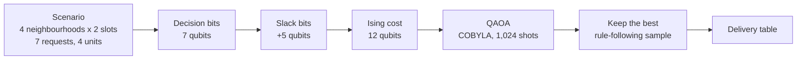

# Project Title

<div align="center">

**WATERWEAVE**

*Seven deliveries requested. Water for four. Who goes without?*

A drought-time water rationing problem, solved three ways: a quick rule of thumb, an exhaustive search, and a quantum circuit. All three run live in a web app that can present itself.


[The story](#1-project-overview--motivation) · [Run it](#installation--execution-instructions) · [See the demo](#4-implementation-walkthrough--live-demo) · [The honest results](#6-performance-results--limitations)

</div>

---

## Project Metadata

* **Project Title:** WATERWEAVE: Fair Water Allocation with Quantum Optimization
* **Team Name:** WATERWEAVE Project Team
* **Chosen Track:** Track 2: Open-Domain Optimization & Real-World Solvers
* **Video Presentation Link:** *[Pending: submission video URL, to be added before the deadline]*
  *(Access must be "Anyone with the link can view" on Google Drive, or "Unlisted / Public" on YouTube. Locked links cannot be scored.)*
* **Live Demo Timestamp in Video:** *[Pending: e.g. 02:15, once the video is recorded]*

### Team Members (Max 4 members)
| Name | Email | GitHub Username |
| :--- | :--- | :--- |
| Yukith M Joseph | yukithj@gmail.com | [@Zynx095](https://github.com/Zynx095) |

---

## 1. Project Overview & Motivation

* **Summary (3–4 sentences):**
  When a city has less water than people are asking for, somebody has to decide who gets it and when. WATERWEAVE turns that decision into a small, checkable maths problem: seven delivery requests, water for four, and a fairness rule that stops any one neighbourhood from being quietly forgotten. We solve it with a simple rule of thumb, with an exhaustive search that is guaranteed to find the best answer, and with a 12-qubit QAOA circuit built in Qiskit. A web app runs all three on the real engine and can walk an audience through the results on its own.

* **Why this problem / game?**
  My grandmother's house is in New BEL, in Bengaluru, and there were stretches when the water just did not come.

  It was never a headline. The tap would cough, hiss and give up, and the house would start doing quiet arithmetic. How much is left in the sump? What has to be kept for cooking? Who bathes today? Whatever we decided, the same thought sat underneath: somewhere, somebody had opened or closed a valve, and our street had been told to wait.

  I never found out how that choice was made, or whether it was fair to the streets that did get water. So when the hackathon asked for a real-world optimisation problem, that tap was the first thing I thought of. WATERWEAVE is my attempt to make the choice visible: put the requests on a grid, make the rules explicit, and let anybody see what each way of deciding would cost.

  It is also a good fit for QAOA. "Be fair to every pair of neighbourhoods" turns into pairwise terms that look exactly like the energy of a small magnet network, which is the language QAOA speaks. It is small enough to read on a screen and still close enough to real life to matter.

  *A note on honesty: every number here is made up. Demand, supply and storage are synthetic, population figures are illustrative, and nothing comes from a real water utility. The project is about the method, not about any real network.*

---

## 2. Quantum Architecture & Mechanics

* **Core Quantum Principles Used:**
  * **Superposition.** Hadamard gates put the circuit into an even mix of all 2^12 = 4,096 possible plans at once.
  * **A cost Hamiltonian (the Ising model).** Each yes/no delivery choice becomes one qubit. The cost of a plan is written as energy: single-qubit rotations for "how much shortage does this choice cause", and two-qubit RZZ gates for "how much do these two choices interfere" (fairness, supply limits, storage limits).
  * **A mixer.** RX rotations let neighbouring plans interfere so probability can move around instead of staying put.
  * **A variational loop.** A classical optimiser (SciPy COBYLA, started from a 36-point grid so runs are repeatable) tunes two angles per layer, gamma and beta, to lower the expected energy.
  * **Measurement.** We sample 1,024 shots, throw away plans that break a rule, and keep the best one that is left. That last step is ordinary classical code, and we say so.

* **How the Quantum Circuit is Integrated:**
  A delivery choice is one yes/no question: does neighbourhood *i* get a unit of water in slot *t*? On the default 4×2 scenario that is 7 real questions, so 7 decision qubits.

  Supply limits ("at most 2 units in the morning") and storage limits ("this house can only hold 1 unit") are inequalities, and qubits cannot enforce those directly. We add 5 extra "slack" qubits that soak up the unused capacity, which turns each limit into a penalty the circuit can feel. The measured bit string is then decoded back into a delivery table.



* **Circuit Details:**
  * **Number of Qubits:** 12 (7 decision + 5 slack)
  * **Key Gates Used (p = 1):** 12 H, 39 RZZ (one per non-zero coupling), 12 RZ, 12 RX, then measurement. Depth is 17 at p = 1, 29 at p = 2 and 41 at p = 3. These counts come straight from the engine (`POST /api/model`) and are drawn gate by gate in the app's Quantum lab.
  * **Primitives Used:** Qiskit `StatevectorSampler`. This is a noiseless simulator on a classical computer, not quantum hardware.
  * **Other Technologies Used:** React, TypeScript and Vite for the web app; FastAPI and Uvicorn for a thin API over the engine; Streamlit and Plotly for the original dashboard; NumPy, SciPy and Pandas. Qiskit powers the quantum core.

```python
# Build the exact QAOA circuit the engine runs
from qiskit import QuantumCircuit
from waterweave.formulation import build_model
from waterweave.solvers import _build_qaoa_circuit

model = build_model(scenario, fairness_weight=2.0)
qc = _build_qaoa_circuit(model, gammas=[0.404], betas=[0.392])
print(f"Circuit width: {qc.num_qubits} qubits, Depth: {qc.depth()}, "
      f"Gate counts: {dict(qc.count_ops())}")
```

---

## 3. Repository Structure & How to Run

### Project Structure
```text
WATERWEAVE
├── README.md                  this file
├── requirements.txt           Python dependencies
├── pyproject.toml             installs the engine as the `waterweave` package
├── app.py                     the original Streamlit dashboard
├── HACKATHON_GUIDE.md         the official event guide
│
├── src/waterweave/            the engine
│   ├── formulation.py         QUBO, slack bits, Ising model
│   ├── solvers.py             exact, greedy and QAOA solvers
│   ├── metrics.py             fairness, disparity, feasibility
│   ├── optimization.py        run_comparison() and a small CLI
│   ├── scenarios.py           the synthetic 4x2 scenario
│   ├── api/                   FastAPI layer (python -m waterweave.api)
│   └── data/                  live and static data providers, cache
│
├── frontend/                  React + TypeScript web app
│   ├── src/pages/             overview, workspace, comparison, data, quantum lab
│   ├── src/presentation/      the self-presenting walkthrough and presenter view
│   └── e2e/                   Playwright browser tests
│
├── notebooks/                 executed demo notebooks (solution.ipynb)
├── references/                Track 2 reference material from the template
├── docs/                      formulation, validation, API, data, Windows setup
├── scripts/                   benchmark runner, snapshot exporter
├── benchmark_results/         reproducible benchmark data
└── tests/                     pytest suite
```

### Installation & Execution Instructions

> **Environment recommendation:** Python 3.11 or 3.12 in a fresh virtual environment, and Node.js 22.12 or newer for the web app. Windows user? There is a step-by-step PowerShell guide with troubleshooting in [`docs/WINDOWS_SETUP.md`](docs/WINDOWS_SETUP.md).

1. **Clone the repository:**
   ```bash
   git clone https://github.com/Zynx095/WATERWEAVE.git
   cd WATERWEAVE
   ```
2. **Create an environment and install the Python dependencies:**
   ```bash
   python -m venv .venv
   source .venv/bin/activate       # Windows: .venv\Scripts\activate
   pip install -r requirements.txt
   pip install -e .
   ```
3. **Build the web app once:**
   ```bash
   cd frontend
   npm ci
   npm run build
   cd ..
   ```
4. **Start WATERWEAVE.** One process serves both the API and the web app:
   ```bash
   python -m waterweave.api
   ```
   Open <http://127.0.0.1:8000>. No API keys or environment variables are needed.

   | Flag | What it does |
   | :--- | :--- |
   | `--port 8080` | use another port |
   | `--host 0.0.0.0` | listen on every network interface (the API has no login, so only do this on a network you trust) |
   | `--offline` | never contact network data providers (same as `WATERWEAVE_OFFLINE=1`) |

5. **Start the guided presentation:** press **Present** in the header. The preflight runs the real engine once, checks live weather, then offers *Start with the live engine* (or *Start with the recorded run* if the API is down). For a second screen, open <http://127.0.0.1:8000/presenter> in another window of the same browser.
