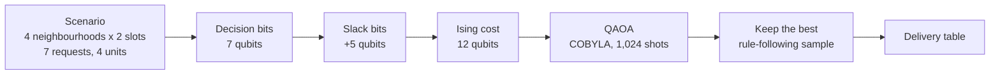

# Project Title

<div align="center">

**WATERWEAVE**

*Seven deliveries requested. Water for four. Who goes without?*

A drought-time water rationing problem, solved three ways: a quick rule of thumb, an exhaustive search, and a quantum circuit. All three run live in a web app that can present itself.


[The story](#1-project-overview--motivation) · [Run it](#installation--execution-instructions) · [See the demo](#4-implementation-walkthrough--live-demo) · [The honest results](#6-performance-results--limitations)

</div>

---

## Project Metadata

* **Project Title:** WATERWEAVE: Fair Water Allocation with Quantum Optimization
* **Team Name:** WATERWEAVE Project Team
* **Chosen Track:** Track 2: Open-Domain Optimization & Real-World Solvers
* **Video Presentation Link:** *[Pending: submission video URL, to be added before the deadline]*
  *(Access must be "Anyone with the link can view" on Google Drive, or "Unlisted / Public" on YouTube. Locked links cannot be scored.)*
* **Live Demo Timestamp in Video:** *[Pending: e.g. 02:15, once the video is recorded]*

### Team Members (Max 4 members)
| Name | Email | GitHub Username |
| :--- | :--- | :--- |
| Yukith M Joseph | yukithj@gmail.com | [@Zynx095](https://github.com/Zynx095) |

---

## 1. Project Overview & Motivation

* **Summary (3–4 sentences):**
  When a city has less water than people are asking for, somebody has to decide who gets it and when. WATERWEAVE turns that decision into a small, checkable maths problem: seven delivery requests, water for four, and a fairness rule that stops any one neighbourhood from being quietly forgotten. We solve it with a simple rule of thumb, with an exhaustive search that is guaranteed to find the best answer, and with a 12-qubit QAOA circuit built in Qiskit. A web app runs all three on the real engine and can walk an audience through the results on its own.

* **Why this problem / game?**
  My grandmother's house is in New BEL, in Bengaluru, and there were stretches when the water just did not come.

  It was never a headline. The tap would cough, hiss and give up, and the house would start doing quiet arithmetic. How much is left in the sump? What has to be kept for cooking? Who bathes today? Whatever we decided, the same thought sat underneath: somewhere, somebody had opened or closed a valve, and our street had been told to wait.

  I never found out how that choice was made, or whether it was fair to the streets that did get water. So when the hackathon asked for a real-world optimisation problem, that tap was the first thing I thought of. WATERWEAVE is my attempt to make the choice visible: put the requests on a grid, make the rules explicit, and let anybody see what each way of deciding would cost.

  It is also a good fit for QAOA. "Be fair to every pair of neighbourhoods" turns into pairwise terms that look exactly like the energy of a small magnet network, which is the language QAOA speaks. It is small enough to read on a screen and still close enough to real life to matter.

  *A note on honesty: every number here is made up. Demand, supply and storage are synthetic, population figures are illustrative, and nothing comes from a real water utility. The project is about the method, not about any real network.*

---

## 2. Quantum Architecture & Mechanics

* **Core Quantum Principles Used:**
  * **Superposition.** Hadamard gates put the circuit into an even mix of all 2^12 = 4,096 possible plans at once.
  * **A cost Hamiltonian (the Ising model).** Each yes/no delivery choice becomes one qubit. The cost of a plan is written as energy: single-qubit rotations for "how much shortage does this choice cause", and two-qubit RZZ gates for "how much do these two choices interfere" (fairness, supply limits, storage limits).
  * **A mixer.** RX rotations let neighbouring plans interfere so probability can move around instead of staying put.
  * **A variational loop.** A classical optimiser (SciPy COBYLA, started from a 36-point grid so runs are repeatable) tunes two angles per layer, gamma and beta, to lower the expected energy.
  * **Measurement.** We sample 1,024 shots, throw away plans that break a rule, and keep the best one that is left. That last step is ordinary classical code, and we say so.

* **How the Quantum Circuit is Integrated:**
  A delivery choice is one yes/no question: does neighbourhood *i* get a unit of water in slot *t*? On the default 4×2 scenario that is 7 real questions, so 7 decision qubits.

  Supply limits ("at most 2 units in the morning") and storage limits ("this house can only hold 1 unit") are inequalities, and qubits cannot enforce those directly. We add 5 extra "slack" qubits that soak up the unused capacity, which turns each limit into a penalty the circuit can feel. The measured bit string is then decoded back into a delivery table.



* **Circuit Details:**
  * **Number of Qubits:** 12 (7 decision + 5 slack)
  * **Key Gates Used (p = 1):** 12 H, 39 RZZ (one per non-zero coupling), 12 RZ, 12 RX, then measurement. Depth is 17 at p = 1, 29 at p = 2 and 41 at p = 3. These counts come straight from the engine (`POST /api/model`) and are drawn gate by gate in the app's Quantum lab.
  * **Primitives Used:** Qiskit `StatevectorSampler`. This is a noiseless simulator on a classical computer, not quantum hardware.
  * **Other Technologies Used:** React, TypeScript and Vite for the web app; FastAPI and Uvicorn for a thin API over the engine; Streamlit and Plotly for the original dashboard; NumPy, SciPy and Pandas. Qiskit powers the quantum core.

```python
# Build the exact QAOA circuit the engine runs
from qiskit import QuantumCircuit
from waterweave.formulation import build_model
from waterweave.solvers import _build_qaoa_circuit

model = build_model(scenario, fairness_weight=2.0)
qc = _build_qaoa_circuit(model, gammas=[0.404], betas=[0.392])
print(f"Circuit width: {qc.num_qubits} qubits, Depth: {qc.depth()}, "
      f"Gate counts: {dict(qc.count_ops())}")
```

---

## 3. Repository Structure & How to Run

### Project Structure
```text
WATERWEAVE
├── README.md                  this file
├── requirements.txt           Python dependencies
├── pyproject.toml             installs the engine as the `waterweave` package
├── app.py                     the original Streamlit dashboard
├── HACKATHON_GUIDE.md         the official event guide
│
├── src/waterweave/            the engine
│   ├── formulation.py         QUBO, slack bits, Ising model
│   ├── solvers.py             exact, greedy and QAOA solvers
│   ├── metrics.py             fairness, disparity, feasibility
│   ├── optimization.py        run_comparison() and a small CLI
│   ├── scenarios.py           the synthetic 4x2 scenario
│   ├── api/                   FastAPI layer (python -m waterweave.api)
│   └── data/                  live and static data providers, cache
│
├── frontend/                  React + TypeScript web app
│   ├── src/pages/             overview, workspace, comparison, data, quantum lab
│   ├── src/presentation/      the self-presenting walkthrough and presenter view
│   └── e2e/                   Playwright browser tests
│
├── notebooks/                 executed demo notebooks (solution.ipynb)
├── references/                Track 2 reference material from the template
├── docs/                      formulation, validation, API, data, Windows setup
├── scripts/                   benchmark runner, snapshot exporter
├── benchmark_results/         reproducible benchmark data
└── tests/                     pytest suite
```

### Installation & Execution Instructions

> **Environment recommendation:** Python 3.11 or 3.12 in a fresh virtual environment, and Node.js 22.12 or newer for the web app. Windows user? There is a step-by-step PowerShell guide with troubleshooting in [`docs/WINDOWS_SETUP.md`](docs/WINDOWS_SETUP.md).

1. **Clone the repository:**
   ```bash
   git clone https://github.com/Zynx095/WATERWEAVE.git
   cd WATERWEAVE
   ```
2. **Create an environment and install the Python dependencies:**
   ```bash
   python -m venv .venv
   source .venv/bin/activate       # Windows: .venv\Scripts\activate
   pip install -r requirements.txt
   pip install -e .
   ```
3. **Build the web app once:**
   ```bash
   cd frontend
   npm ci
   npm run build
   cd ..
   ```
4. **Start WATERWEAVE.** One process serves both the API and the web app:
   ```bash
   python -m waterweave.api
   ```
   Open <http://127.0.0.1:8000>. No API keys or environment variables are needed.

   | Flag | What it does |
   | :--- | :--- |
   | `--port 8080` | use another port |
   | `--host 0.0.0.0` | listen on every network interface (the API has no login, so only do this on a network you trust) |
   | `--offline` | never contact network data providers (same as `WATERWEAVE_OFFLINE=1`) |

5. **Start the guided presentation:** press **Present** in the header. The preflight runs the real engine once, checks live weather, then offers *Start with the live engine* (or *Start with the recorded run* if the API is down). For a second screen, open <http://127.0.0.1:8000/presenter> in another window of the same browser.

6. **Run the tests:**
   ```bash
   pytest                               # Python: engine, metrics, API, recorded-run check

   cd frontend
   npm test                             # Vitest: components, pages, presentation logic
   npx playwright install chromium      # once, downloads the test browser
   npm run e2e                          # Playwright: real API, real browser
   ```
   `npm run e2e` starts the API itself. Set `WATERWEAVE_PYTHON` to the interpreter that has the project installed. If the browser download is blocked, set `PLAYWRIGHT_CHANNEL=msedge` (or `chrome`) to use a browser you already have.

7. **Other ways in:**
   ```bash
   python -m waterweave.optimization                  # command line: greedy vs exact vs QAOA
   streamlit run app.py                               # the original Streamlit dashboard
   python scripts/benchmark.py                        # the benchmark (seeds 0..4, p = 1..3)
   jupyter notebook notebooks/solution.ipynb          # executed walkthrough notebook
   cd frontend && npm run dev                         # live-reload web app on :5173
   ```

<details>
<summary><b>Troubleshooting</b></summary>

| What you see | What to do |
| :--- | :--- |
| "The WATERWEAVE API is not reachable" | Start `python -m waterweave.api` and press **Retry**. To present anyway, choose **Show recorded run**; everything is then labelled as recorded. |
| The page says "WATERWEAVE API is running" instead of the app | The frontend has not been built. Run `cd frontend && npm ci && npm run build`, then restart. |
| A page says it "could not be displayed" | The API and the built frontend are different versions. Rebuild the frontend and restart the API. |
| QAOA says "Not run: this scenario needs N qubits" | Live simulation is capped at 15 qubits so answers come back in seconds. Greedy and exact still run. |
| Live weather is unavailable | Nothing depends on it. Use `--offline` to skip the network completely. |
| Port 8000 is busy | Start with `--port 8001` and open that port. |

</details>

---

## 4. Implementation Walkthrough & Live Demo

* **Walkthrough of Gameplay / Optimization Pipeline:**
  The app has five pages, and each one answers a question a sceptical judge would ask.

  | Page | The question it answers |
  | :--- | :--- |
  | **Overview** | What is the problem, in numbers? Seven deliveries requested, water for four, drawn as a grid of "who wants what, when". |
  | **Workspace** | Can I change it and watch? Click a crossing to add or remove a request, set supply, priority and storage, then run greedy, exact and QAOA. Every plan is drawn as a weave with its score, requests met, fairness and how far it is from the best possible. |
  | **Classical vs quantum** | Does the quantum solver actually help? All three on the same scenario and score, plus the recorded benchmark with a random-sampling control and six audit checks. |
  | **Data sources** | What is real and what is invented? Every input is labelled live, cached, illustrative, synthetic or unavailable. |
  | **Quantum lab** | What is the circuit really doing? Eight steps from yes/no decisions to measurement, with plain words first and the maths behind a click. It draws the exact circuit QAOA ran. |

  **Reading the weave.** A blue thread crossing is a delivered unit. An open red ring is a request that was not met. Every crossing also has a text state for screen readers. If a solver fails, it is shown as failed with the reason; no other solver's answer is put in its place.

  **The app presents itself.** Press **Present** and nine steps play through the real app in about four minutes: the problem, the scenario, the rules, the classical solvers, the quantum run, the results and fairness, data integrity, the honest comparison, and a conclusion. Each step goes to its page, highlights the part it is talking about and runs its real action. Everything said on the captions comes from the numbers the engine just produced, so nothing is read out that was not computed.

  | Do this | Press |
  | :--- | :--- |
  | Pause or resume | `Space` |
  | Next or previous step | `→` `←` (or `Page Down` / `Page Up` from a clicker) |
  | Restart | `Home` |
  | Presenter notes | `N` |
  | Clean audience view | `H` |
  | Exit | `Esc` |

  A few things it does so that a live talk does not fall apart:
  * **Auto or manual.** It advances itself by default; switch that off in the preflight to move by hand. Pace goes from a one-minute quick check to a slow, relaxed pass.
  * **An honest clock.** Pausing stops it at once. While the engine is still working, the clock waits. If a step fails, the show pauses with the reason and a **Retry** button.
  * **A presenter view** at `/presenter` for a second screen: current step, time left, notes, what the audience is reading and big controls. It talks to the main window directly in the browser (no server) and only sends commands to the window it is paired with.
  * **Offline.** The solvers run on your machine and need no internet. If the API itself is down, *Start with the recorded run* replays real, earlier API output, and every result is labelled "Recorded run".

  **What is real and what is not.** We would rather show a gap than invent a number.

  | Label | Source | Used for |
  | :--- | :--- | :--- |
  | Live | Open-Meteo: current rainfall for Bengaluru, 10 s timeout, cached 5 minutes | Context only. The rainfall-to-supply rule is switched off, because rain today does not tell you how much water a utility can pipe today. |
  | Illustrative | Hard-coded neighbourhood populations (not census records) | Priority weights in one optional preset. |
  | Synthetic | All demand, supply and storage figures | Every scenario and the whole benchmark. |
  | Unavailable | Reservoir levels, pipe flow, ward-level demand: there is no public real-time feed | Nothing, and none is claimed. |

  A failed fetch is reported as missing, with its error, and never replaced by an invented value. No scenario depends on live data.

* **Key Screenshots / Terminal Output:**

<details>
<summary><b>Real output of <code>python -m waterweave.optimization</code> (click to expand)</b></summary>

```text
======================================================================
WATERWEAVE Optimization Comparison
Scenario: synthetic-4x2 (4 neighborhoods, 2 delivery slots)
======================================================================

--- Greedy (Priority-First) ---
  Feasible:             True
  Objective Value:      7.0000
  Weighted Shortage:    5.50
  Fairness Score:       0.5000
  Disparity (QUBO):     0.7500
  Service Level:        42.86%
  Allocated / Demand:   3/7 units
  Runtime:              0.0009 s
  Allocation:
    N1: {'morning': 1, 'evening': 0}
    N2: {'morning': 0, 'evening': 1}
    N3: {'morning': 0, 'evening': 0}
    N4: {'morning': 1, 'evening': 0}

--- Exact Classical (Optimal) ---
  Feasible:             True
  Objective Value:      6.0000
  Weighted Shortage:    4.50
  Fairness Score:       0.5000
  Disparity (QUBO):     0.7500
  Service Level:        57.14%
  Allocated / Demand:   4/7 units
  Runtime:              0.0034 s
  Allocation:
    N1: {'morning': 0, 'evening': 1}
    N2: {'morning': 0, 'evening': 1}
    N3: {'morning': 1, 'evening': 0}
    N4: {'morning': 1, 'evening': 0}

--- QAOA (Quantum Heuristic) ---
  Feasible:             True
  Objective Value:      6.0000
  Weighted Shortage:    4.50
  Fairness Score:       0.5000
  Disparity (QUBO):     0.7500
  Service Level:        57.14%
  Allocated / Demand:   4/7 units
  Runtime:              0.3544 s
  Allocation:
    N1: {'morning': 0, 'evening': 1}
    N2: {'morning': 1, 'evening': 0}
    N3: {'morning': 1, 'evening': 0}
    N4: {'morning': 0, 'evening': 1}
  QAOA Circuit:         depth=17, qubits=12, shots=1024
  Feasible Samples:     74.41%

======================================================================
```

</details>

---

## 5. Classical vs. Quantum Comparison

* **Classical Baseline / Counterpart:**
  Three contenders, one shared score, one scenario.

  * **Greedy.** Hands out one delivery at a time, always taking the move that lowers the score most, then tidies up with a local search. We built it after finding that the naive "highest priority first" rule scores 11.0, which is worse than delivering nothing at all (10.0). So our baseline is not a strawman: it scores 7.0 in under a millisecond.
  * **Exact search.** Checks all 2^7 = 128 plans and returns the true best: a score of 6.0 in about 3.5 ms. This is the yardstick for everything else.
  * **QAOA.** The 12-qubit circuit above, simulated on a laptop.
  * **A random-guess control.** The same number of samples (1,024) drawn uniformly at random from the same 12-qubit space, with the same filtering. It exists to answer one question honestly: does QAOA beat just guessing?

* **Comparative Analysis:**

  | Measure | Result |
  | :--- | :--- |
  | **Approximation ratio** (QAOA / optimal) | 1.00 for the best run, about 1.011 on average (6.067 / 6.0). QAOA reached the optimum in 14 of 15 recorded runs across seeds and depths. |
  | **Feasibility yield** | 74.6% of QAOA samples followed the rules at p = 1, 63.0% at p = 2, 65.5% at p = 3, against 50.8% for random sampling. |
  | **Against random guessing** | 3 of the 128 plans are optimal, so a random sampler finds one in 15 of 15 runs (the chance of missing is about 3 in 100 billion). At this size, best-of-1,024 sampling cannot tell QAOA apart from guessing. |
  | **Run time** | Exact search: about 3.5 ms. QAOA simulation: about 330 to 730 ms. Classical search is roughly 100 times faster here. |

  **In one line:** QAOA finds the optimum, and so does throwing darts, at a thousandth of the cost. We report that on purpose.

  Two things we noticed and did not hide. First, "fairness score" and "disparity" are different numbers that can rank plans in opposite orders, so both are shown. Second, the most frequent bit string QAOA measured was often one that broke a rule; the answer we report comes from picking the best rule-following sample afterwards.

---

## 6. Performance, Results & Limitations

* **Key Results & Observations:**
  Default 4×2 scenario, seeds 0 to 4, p = 1 to 3. Reproduce with `python scripts/benchmark.py`.

  | Solver | Depth p | Feasible | Hit optimum | Objective (mean ± SD) | Median time | Feasible samples |
  | :--- | :---: | :---: | :---: | :---: | :---: | :---: |
  | Greedy | n/a | 100% | 0% | 7.000 ± 0.000 | 0.0009 s | n/a |
  | Exact (optimal) | n/a | 100% | 100% | 6.000 ± 0.000 | 0.0035 s | n/a |
  | QAOA | 1 | 100% | 80% | 6.200 ± 0.447 | 0.3279 s | 74.6% |
  | QAOA | 2 | 100% | 100% | 6.000 ± 0.000 | 0.5501 s | 63.0% |
  | QAOA | 3 | 100% | 100% | 6.000 ± 0.000 | 0.7304 s | 65.5% |
  | Random control | n/a | 100% | 100% | 6.000 ± 0.000 | 0.0003 s | 50.8% |

  **Tests, measured on this branch:** 163 Python tests pass (1 optional live-fetch test is skipped), 118 frontend unit tests pass, and 23 browser tests pass. The browser tests play the whole presentation against the real engine and include an automated accessibility audit and a Windows high-contrast check.

* **Critical Reflection on Limitations:**
  * **No quantum advantage, and none claimed.** On this benchmark exact search is far faster than simulated QAOA, and random sampling matches its hit rate.
  * **It is a simulation.** The circuit ran on a noiseless classical simulator. On a real device, two-qubit gate errors, decoherence and readout errors would hurt a 39-RZZ, depth-17 circuit badly, and we would need error mitigation and many more shots.
  * **It does not scale as built.** Slack qubits grow with the size of each limit, and the live app caps simulation at 15 qubits so answers return in seconds. Bigger networks would need a more compact encoding.
  * **The data is made up.** Scenarios are benchmarks for the optimisation method, not a model of any real pipe network or utility.
  * **App limits.** The recorded fallback only covers the default scenario with default settings. Each delivery is one unit, so per-slot demand is 0 or 1. The presenter view needs both windows in the same browser. It has not been tried on a real projector, in Firefox or Safari, or with a screen reader.

---

## 7. References & Acknowledgments

* **Hackathon reference:** the pipeline shape (binary decisions, quadratic penalties, Ising mapping, QAOA simulation, exact baselines, feasibility yield) follows the Track 2 guide in the [Qiskit Fall Fest 2026 IIIT Kottayam template](https://github.com/Shanwis/Qiskit-Fall-Fest-2026-IIITKottayam-Hackathon-Template/tree/main/references/track-2-optimization) (MIT).
* **The algorithm:** E. Farhi, J. Goldstone, S. Gutmann, *A Quantum Approximate Optimization Algorithm*, 2014, [arXiv:1411.4028](https://arxiv.org/abs/1411.4028).
* **Weather data:** [Open-Meteo](https://open-meteo.com/) (CC BY 4.0).
* **Software:** [Qiskit](https://github.com/Qiskit/qiskit), [NumPy](https://numpy.org/), [SciPy](https://scipy.org/), [Pandas](https://pandas.pydata.org/), [Streamlit](https://streamlit.io/), [Plotly](https://plotly.com/), [FastAPI](https://fastapi.tiangolo.com/), [Uvicorn](https://www.uvicorn.org/), [React](https://react.dev/), [React Router](https://reactrouter.com/), [Vite](https://vite.dev/), [TypeScript](https://www.typescriptlang.org/), [Lucide](https://lucide.dev/), [Vitest](https://vitest.dev/), [Testing Library](https://testing-library.com/) and [Playwright](https://playwright.dev/).
* **Fonts:** Barlow Condensed and Atkinson Hyperlegible Next (both SIL OFL), bundled through [Fontsource](https://fontsource.org/).
* **Acknowledgments:** the formulation was independently audited in the validation workstream, and the web app, API and presentation mode were built and reviewed with the help of Claude Code. My grandmother, whose tap started all of this.

<div align="center">

*Every number in this README is produced by the engine or cited from its docs. None is a real-world measurement.*

</div>
